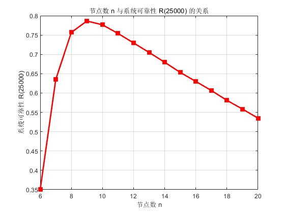
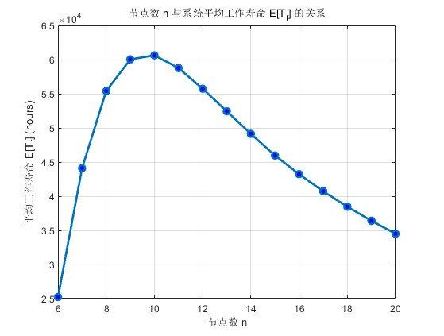

# 案例2：多节点声纳同步时钟系统的可靠性优化

## 问题概述

系统由 $n=6,\ldots,20$ 个节点组成，每个节点包含两类不可修复切换器。切换器寿命服从指数分布，故障模式决定节点属于 PF、SO、DM、MO、DN 或 FB 六种能力状态。系统需要至少 $k=6$ 个有效主从节点，并可能因总线阻塞、多个强制主节点、主节点资源枯竭或有效节点不足而首次失效。

目标是估计：

- $R(25000)=\Pr(T_f\ge 25000)$；
- 平均首次失效时间 $\operatorname{E}(T_f)$；
- 分别使这两个指标最大的初始节点数。

## 方法

代码采用事件驱动蒙特卡洛仿真：预先抽样所有元件的寿命和故障类型，每次只推进到下一个故障事件；节点状态通过 $4\times3$ 查表更新，六类节点数量用“能力分桶”进行 $O(1)$ 差分维护。样本在首次失效时立即停止，从而避免把后续“复活”误计为可靠。

## 结果

历史完整实验使用每个节点规模 $S=500000$ 个样本，得到：

- 最大平均寿命：$n=10$，$\operatorname{E}(T_f)\approx60626.7$ h；
- 最大 25000 h 可靠度：$n=9$，$R(25000)\approx0.7863$。

结果呈单峰而非单调上升：增加节点最初提供冗余，随后也提高 FB 总线阻塞和多 MO 主节点冲突的机会。





## 运行

快速验证：

```matlab
run('src/run_quick.m')
```

该脚本固定 $n=10$、$S=1000$，适合检查模型和程序能否运行。完整实验：

```matlab
run('src/run_full.m')
```

完整实验遍历 $n=6:20$ 且每个规模使用 $S=500000$，运行时间较长。两个脚本都固定随机种子，并使用逆变换抽样生成指数寿命，不依赖统计工具箱。

## 局限

- 结果依赖课程给定的独立、指数寿命和不可修复假设；
- 250000 h 的寿命上限是为处理模型中的“无限寿命”组合而设定的截断；
- 蒙特卡洛结果应同时报告样本量和随机误差，不应把四位小数理解为解析精度；
- 仿真没有建模相关故障、维修策略、通信时延和环境共同冲击。
